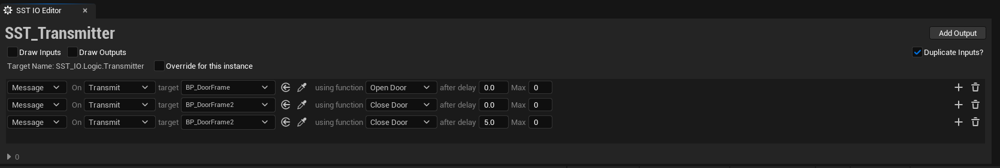
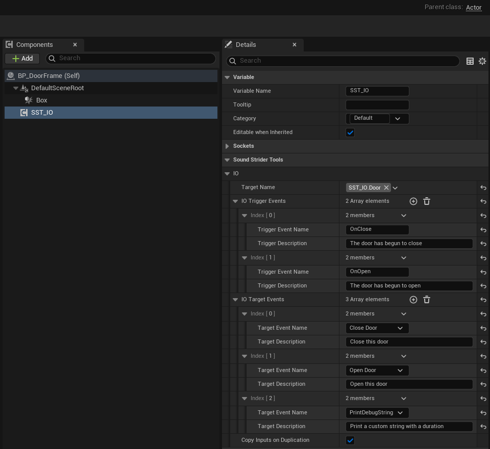
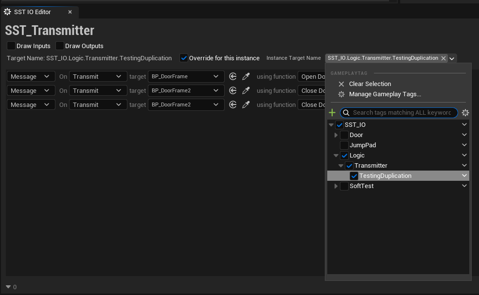
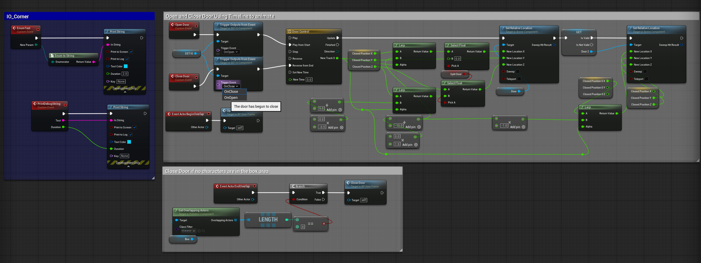
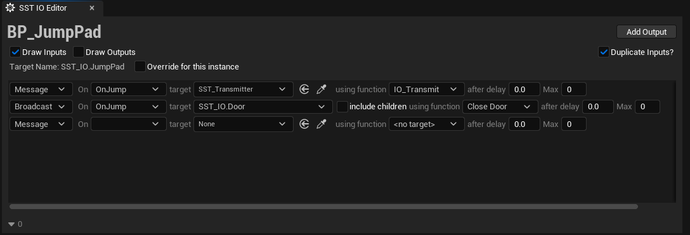
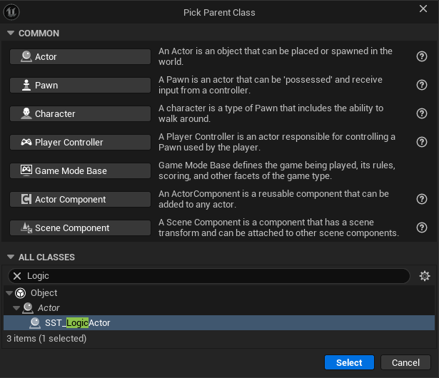
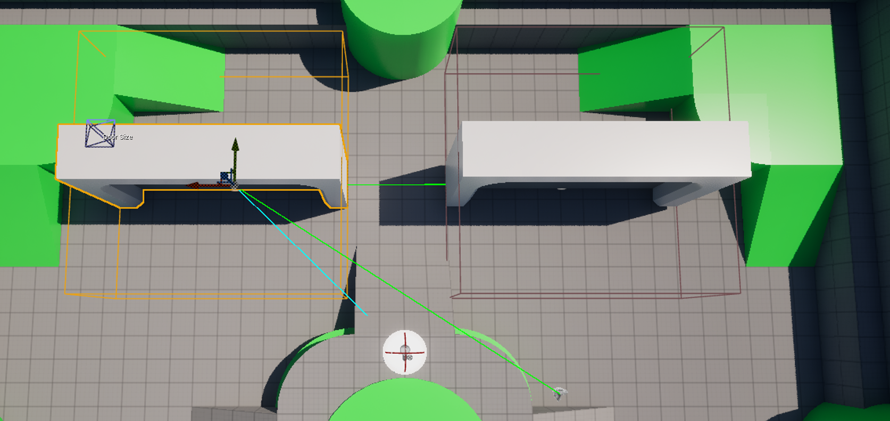
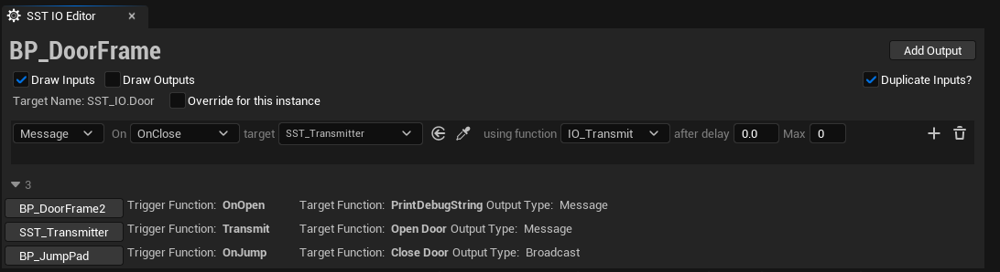
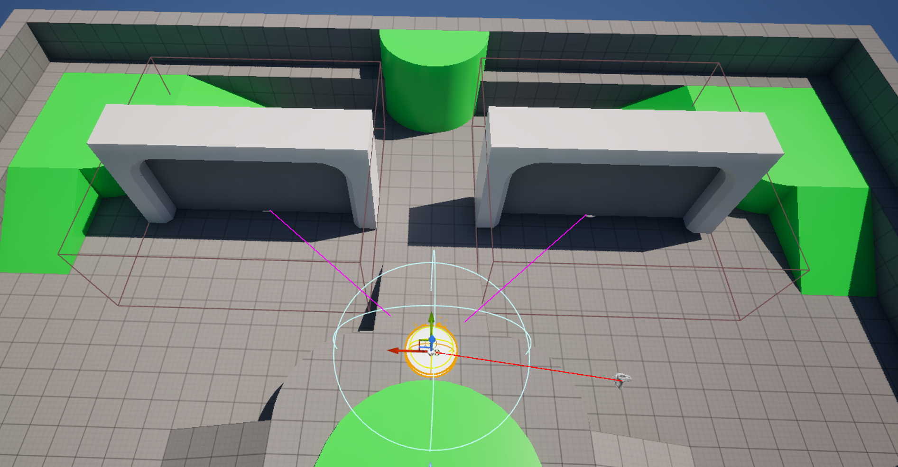
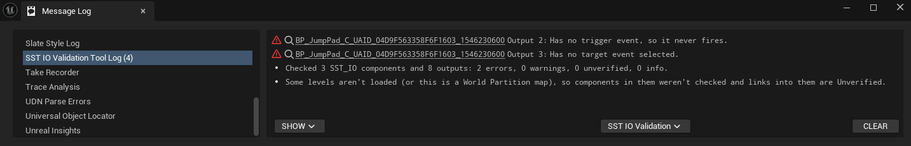

# About

---
SoundStriderTools is currently in Beta release. Versions of this plugin from GitHub fall under a PolyForm Noncommercial License 1.0.0 . 
Once SoundStriderTools - Dev - is out of Beta, a commercial license will be available on the FAB. 

SoundStriderTools - Dev is a collection of Unreal Engine tools intended for designers to improve workflows and ease development struggles. 
Currently, the only tool included in this package is the Scripting_IO tool (SST_IO) and its related features and editor tools. 

>[!WARNING]
> This product is still in Beta and may have bugs and instability. If you encounter anything, reach out to @soundstrider.dev on [Bluesky](https://bsky.app/profile/soundstrider.dev) or file a bug at [SoundStrider.dev](https://www.soundstrider.dev/about/contact)

<!-- INTRODUCTION SECTION --> 
# SST_IO

---
Introducing SoundStriderTools Input-Output scripting! This is a feature set that is modeled after
the scripting system present in the Source Engine by Valve&trade; Software, as well as other Unreal Scripting such as [ActorIO](https://github.com/HorizonGamesRoland/ActorIO) and [JoeIO](https://www.joewintergreen.com/i-o-systems-for-level-scripting/). 
It works by defining on an Actor basis what that actor is allowed to do. An actor will have defined `Trigger Events` (notify that it has performed an action) 
and `Target Events` (what it is able to do). A designer will then be able to use the Scripting Editor Tool to have an actor (A) target another actor (B), and when Actor A's `Trigger Event` is hit, Actor B can perform the set `Target Event`. 

<!-- HOW IT WORKS SECTION --> 
# How Does it Work?

---
SST_IO is fairly simple to get up and running. First a designer will take a Blueprint (BP) Actor and add an SST_IO Actor Component to the BP.
From there they would go into the SST_IO details and begin defining that Actor's `TargetName`, `TriggerEvent`, and `TargetEvent`.

<!-- TARGET NAME --> 

<h3> Target Name </h3>

>An Actor's `TargetName` is a GameplayTag that is created by the user to give a name to a class of Actor. The prefix `SST_IO` is built into the plugin, so it’s always there and can’t be renamed or deleted. 
Tags you create (e.g. SST_IO.Door) are saved to `Config/DefaultGameplayTags.ini` by default. You can save them elsewhere, but every target name must start with `SST_IO.` or the editor tool will be unable to find them.

>Target Names can also have overrides on a per-actor or per-class basis. Examples of this would be 
>- You have a base BP Actor class called `BP_Door` this is functionally just a parent class of logic and never used in the level, and can be called `SST_IO.Door`. You would define all the logic, trigger, and target events here.
Then on the `BP_Door_Wood` child class that's actually implemented in the level, you can override that class at the BP level to use the TargetName `SST_IO.Door.Wood`. 
From there, a broadcast output could target `SST_IO.Door` with an include all children call, and every type of door would receive that broadcast. Alternatively, you could choose
to target only `SST_IO.Door.Wood` and only the wooden doors in that level would receive that call
>- SST_IO_Transmitters are an example of overriding on a per-actor basis. These Logic Actors already start with the override turned on (if the override doesn't actually get set but is left on, it defaults back to the class tag).
This allows for more direct communication, as well as organization, when dealing with lots of the same types of actors. Call one Transmitter `SST_IO.Logic.Transmitter.BossDeath` for when that 
transmitter needs to be told X boss has died, but you don't accidentally want it to get caught in a Broadcast to all Transmitters. Just make sure you have the `Include Children` boolean unchecked on the broadcast!

<!-- TRIGGER EVENT --> 

<h3> Trigger Event </h3>

>Trigger Events are what allows an Input to be called from wherever the function is placed in scripting. A `TriggerEvent` is created by going to the SST_IO Component in the Actor BP and going to the `TriggerEvent` 
section. There you can add to the Array of `IO Trigger Events` with whatever you want them to be defined as. This array is also where you can define a tooltip for the event. 
From there, wherever you want to call in your BP scripting the trigger (my suggestion is at the very front or very end of the function/event) you'll call `Trigger Outputs From Event` 
pulling off the SST_IO component. That function will provide you a drop-down list of all the defined `TriggerEvents`. 

>[!WARNING]
>If `TriggerOutputsfromEvent` is not pulling off the owning actor's SST_IO component, the drop-down will not work, and it will default back to a string text box.
>
>If there are multiple `TriggerEvent` with the same String Name, then the Pin Utility picker will only grab the first one in the array as a Pin utility and disregard and subsequent ones in the array. If multiple trigger
>events using the same name are in a BP graph, they are all valid when they are called. Make sure you're only putting the trigger events where you want them to be fired. 

<!-- TARGET EVENT --> 

<h3> Target Event </h3>

>Target Events are defined in a very similar way to `TriggerEvents`. In the `IO Target Events` array, you'll add a new item to that array. The item in the array will have 2 fields to fill. The same
Tooltip field as the `TriggerEvent`, but instead of a user defined string, the IO Details panel will have a dropdown list of all Custom Events that Actor holds. You will be able to pick from them instead 
of needing a user string value. Target Events will then grab all the inputs the Custom Event uses, and allow them to be set as parameters in the IO Editor Tool.

>[!WARNING]
>Target Events that use inputs that are Pass-by-Reference will not be valid as a `TargetEvent`, or if they use inputs that the tool does not support such as delegates or interfaces. 
>
>Target Events do work with Arrays, Sets, and Maps as inputs.
>
>Blueprint functions, overrides like BeginPlay, event dispatchers and timeline functions are excluded from being valid `TargetEvents`, but events inherited from a parent are valid `TargetEvents`
>
>If there are multiple `TargetEvent` with the same CustomEvent, then only the first one in the array will be considered. `GetOptions` currently cannot remove the option from the `TargetEvent` is already in use.

Add the `TriggerOutputsfromEvent` function in-line wherever you want to have that fire and set the proper `TriggerEvent` from the drop down. 
Set up your custom events how you like and make sure you define them in the `SST_IO` details panel. From there you can begin scripting using the Editor Tool in the game world! 

<!-- EDITOR TOOL SECTION --> 
# SST IO Editor Tool

---
The SST IO Editor is a simple slate widget that is opened up through the Level Editor's primary `Tools` menu. This is the main tool that an end user will be interfacing with, and where all 
the Outputs are defined. A user will select a compatible SST_IO Actor, and then will `Add Output` to it. This will create a row with a few fields of data to fill in. 

<!-- MESSAGE VS BROADCAST --> 

<h3> Message vs Broadcast </h3>

>- Message = Direct Actor -> Actor. Most likely the main form of communication and scripting. You hit Button (A), it will open corresponding Door(A)
>- Broadcast = Actor -> Tag. More niche feature, but extremely powerful. You hit Button(A), it will open all doors of a specific type that are loaded (SST_IO.Door.Wood)
>  - *Note - Broadcast has an option to `Include Children` which means that any SubTags of whatever tag you target will get the broadcast message (`Door.Wood` being a child of `Door` would get all `Door` broadcasts)*

<!-- TRIGGER EVENT --> 

<h3> Trigger Event </h3>

>Select from the Trigger Events defined in the Actor's SST_IO Trigger Events array. When this TriggerEvent is activated, any Output with this TriggerEvent will be sent. 

<!-- TARGET ACTOR / TAG --> 

<h3> Target Actor / Tag </h3>

> Message
>- The drop down will populate with all loaded SST_IO enabled actors in the level. You can also use the Picker Icon to select an actor from the level. 
>If the Target Actor is loaded and enabled, they will receive the message.
>
> Broadcast 
> - You will be able to select an available SST_IO Gameplay Tag to target. When the TriggerEvent is activated, all loaded and enabled actors using that Gameplay Tag will receive the Output.
>  - *Note - Broadcast has an option to `Include Children` which means that any SubTags of whatever tag you target will get the broadcast message (`Door.Wood` being a child of `Door` would get all `Door` broadcasts)*

<!-- TARGET EVENT --> 

<h3> Target Event </h3>

> Select one of the `TargetEvents` from the drop down list. These are created from the IO Components `TargetEvents` array that are set in the details window of the Actor's Blueprint. For C++ actors those 
> will need to be configured in the C++ class. View the `STT_LogicActorBase` or `SST_Transmitter` as C++ Actor examples. 

<!-- DELAY --> 

<h3> Delay </h3>

> A Delay time set as a Float. When the `TriggerEvent` is activated the Output is sent. The SST_Subsystem then checks the delay to see if it should immediately send the message to the `TargetActor` 
> or if it should hold the message and wait out the delay. When the end of the delay is reached, the message is sent to the `TargetActor`. If the target isn't available then - 
> - Messages: Go onto a waitlist and are delivered whenever the target is available 
>   - There is a per-output "Opt-Out" for the Waitlist 
>   - There is a Global project level "Timeout", that if the Message has been in the waitlist for that long then it will be destroyed. This can also be overridden on a per-output basis
> - Broadcasts: Never wait. Any unloaded targets will miss the Broadcast
> - If the map changes the Waitlist is cleared

<!-- ONLY FIRE N TIMES --> 

<h3> Max Times Fired </h3>

> This is the Maximum amount of times that this output can be fired. Once this limit is hit, the Output will not be able to be fired any longer.
>  - A maximum of 0 means the output can fire Infinite amount of times

<!-- PARAMETERS --> 

<h3> Parameters </h3>

> Parameters come from the Inputs that are on the CustomEvent that is being used as a `TargetEvent`. 
> - A Parameter can be an Array, Set, or Map

>[!WARNING]
> - Parameters cannot be Pass-by-References
> - Parameters cannot be Interfaces or Delegates

<!-- LOGIC ACTORS SECTION --> 
# Logic Actors

---

Logic Actors are functional objects that are derived from a base `LogicActor` C++ class. They are a very lightweight framework that hold a sprite to visualize them in the editor level, and an SST_IO component.
This allows for users to create Child Classes that are specific to doing specific types of operations. These Child Classes can be made either in C++ or as Blueprint actors, and the plugin ships with a suite of
logic actors to begin with. 

<!-- DEBUG SECTION -->
# Debugging 

---
## Editor Tool 
The IO Editor Tool has debug drawing functionality for an actor's inputs and outputs. When the actor is selected in the tool, enable the `Draw Inputs` or `Draw Outputs` boolean to enable the drawing. 

<!-- INPUTS --> 

Inputs 

>- Green = Message 
>- Cyan = Broadcast 

>The Editor Tool also allows for the viewing of all incoming events in the drop down widget at the bottom of the tool. 
This area will allow you to navigate to the actor that is sending the incoming message, see what is triggering the message, what is being targeted on the selected actor, and the message type.

<!-- OUTPUTS --> 

Outputs 

>- Red = Message 
>- Magenta = Broadcast 

<!-- VALIDATOR --> 
## SST IO Validator 

The data validator is how a user can check the status of all loaded outputs in the current world. The tool will return if an output is unloaded and unable to be checked. 
The validator will check for missing Targets, missing `TargetEvents`, Parameters that are invalid, and `TriggerEvents` that no longer work. All of this is collected into a named message log
`SST IO Validation Tool Log` in the message log. From the validation log you can directly navigate to actors and fix those invalid outputs, as well as view all validation logs from the current editor session.

Alongside checking all outputs, the Data Validation tool will also check to make sure that everything is functioning correctly on the BP side. This includes checking
- Empty or duplicate trigger and target event entries
- Target events that were renamed or deleted
- Trigger pins that are unset, wired, or not declared
- Broadcasts where some or none of the receivers declare the event
- Parameters that are out of date, and soft or hard references that are broken
- Unloaded levels, which it reports as “isn’t loaded, so … weren’t checked”

<!-- SUPPORT SECTION -->
# Support

---

- Documentation: [WIP - Official Site Coming]
- Email: [soundstridertools@gmail.com](mailto:soundstridertools@gmail.com)